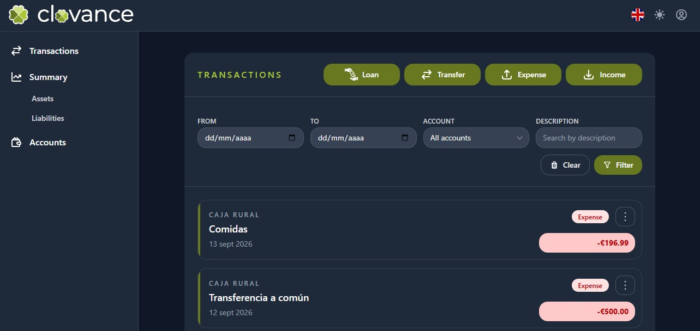
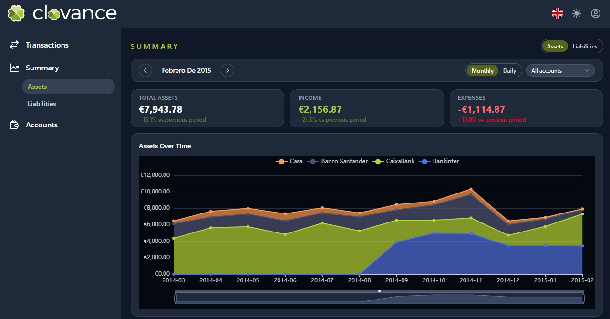
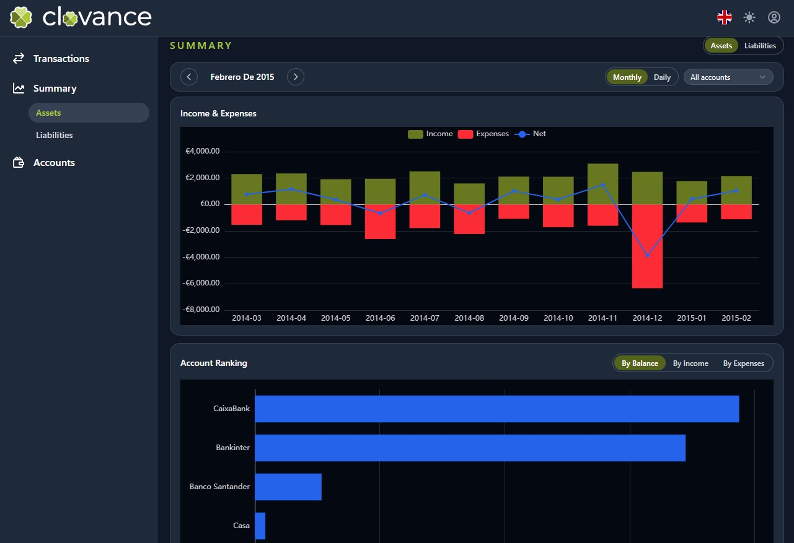

# Clovance

Personal finance management application built with .NET Aspire, Angular, and PostgreSQL. Clovance helps you manage your daily accounting by tracking multiple accounts, recording expenses and income, and keeping a clear history of your financial movements. You can also register transfers between accounts, organize your personal finances in one place, and review statistics to better understand spending patterns and cash flow over time.







## What Clovance does

- Track multiple financial accounts in one place.
- Record expenses and income with a clear history of movements.
- Register transfers between accounts.
- Organize personal finances and review statistics to understand spending patterns and cash flow over time.
- Multi-language UI (English and Spanish).
- Secure authentication with JWT.

## 🚀 Quick Start

### Easy install (recommended)

Install Clovance on Windows, Linux, or macOS with a single command. The installer checks Docker, asks a few questions, generates the configuration, pulls the images, and starts the app.

**Linux / macOS:**

```bash
curl -fsSL https://evaristocuesta.github.io/clovance/install/install.sh | sh
```

**Windows (PowerShell):**

```powershell
irm https://evaristocuesta.github.io/clovance/install/install.ps1 | iex
```

The scripts also support `uninstall` and `update` subcommands. See the [Installation Guide](./INSTALL.md) for all parameters and options. For manual setup, see the [Docker Usage Guide](./DOCKER_USAGE.md).

### Docker Compose (manual)

You can also run Clovance with Docker Compose. For the complete setup, see the [Docker Usage Guide](./DOCKER_USAGE.md).

### Local Development

```bash
# From the repository root
cd api/aspire/Clovance.AppHost
dotnet run
```

This will start:

- API Service
- Frontend
- PostgreSQL with pgWeb
- Aspire Dashboard

### Publish a New Version

```powershell
# Production release
.\scripts\publish-version.ps1 -Version "1.0.0"

# Pre-release (beta, rc, alpha)
.\scripts\publish-version.ps1 -Version "1.0.0-beta1"
```

This creates a Git tag and triggers the GitHub Actions workflow, which publishes the Docker images to GitHub Container Registry.

## 📚 Documentation

- [Docker Usage Guide](./DOCKER_USAGE.md) - Setup, ports, reverse proxy, and operations
- [Docker Image Publishing](./DOCKER_PUBLISH.md) - Publishing and deployment guide
- [Versioning Examples](./VERSIONING_EXAMPLES.md) - Semver tagging reference

## 🏗️ Project Structure

```
Clovance/
├── api/                          # .NET backend
│   ├── aspire/                   # Aspire configuration
│   │   ├── Clovance.AppHost/     # Application orchestration
│   │   └── Clovance.ServiceDefaults/
│   ├── src/
│   │   └── Clovance.ApiService/  # REST API
│   └── tests/
│       ├── Clovance.UnitTests/
│       └── Clovance.IntegrationTests/
├── frontend/                     # Angular frontend
├── scripts/                      # Utility scripts
└── docs/                         # Documentation
```

## 🛠️ Technologies

**Backend:**

- .NET 10
- .NET Aspire
- PostgreSQL
- Entity Framework Core
- JWT Authentication

**Frontend:**

- Angular 22
- TypeScript
- Tailwind CSS
- Flowbite UI

**DevOps:**

- Docker
- GitHub Actions
- GitHub Container Registry (GHCR)

## 📦 Docker Images

Docker images are automatically published to:

- [ghcr.io/evaristocuesta/clovance/clovance-api](https://ghcr.io/evaristocuesta/clovance/clovance-api)
- [ghcr.io/evaristocuesta/clovance/clovance-frontend](https://ghcr.io/evaristocuesta/clovance/clovance-frontend)

## 🤝 Contributing

For contributions, see the [Contributing Guide](https://github.com/evaristocuesta/clovance/blob/main/CONTRIBUTING.md).

## 📄 License

This project is licensed under the Apache License 2.0. See the [LICENSE](https://github.com/evaristocuesta/clovance/blob/main/LICENSE.md) file for details.